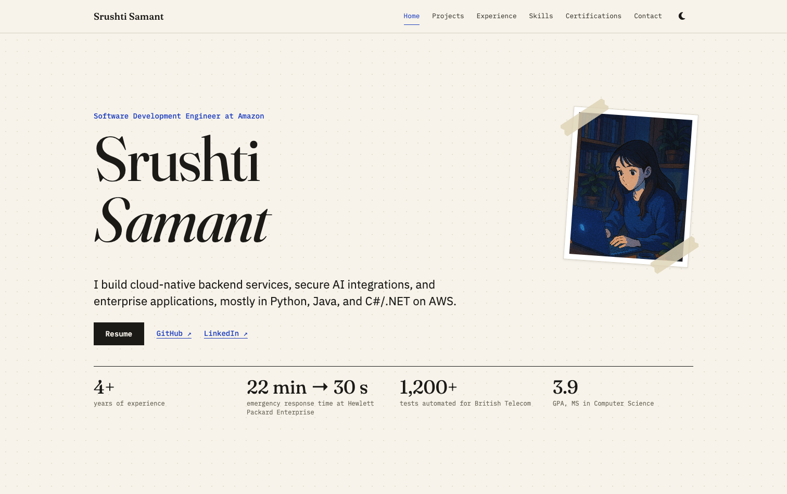

# Srushti Samant | Portfolio

My personal portfolio website, covering my work as a software engineer, my projects, and my certifications.

**Live site:** https://srushtisamant.github.io



## What's on the site

| Section | What it shows |
| --- | --- |
| Home | A short introduction, with links to my resume, GitHub, and LinkedIn |
| Projects | Posturelytics.AI and AI1y, with their tech stacks and source code |
| Experience & Education | A chart of my roles and degrees, drawn to scale like a system trace |
| Skills | Languages, frameworks, databases, cloud and DevOps tools, and security and AI |
| Certifications | A table of Microsoft certifications with credential IDs and links to verify them |
| Contact | My email address, with a button to copy it |

## Features

- A notebook-style light theme by default, with a dark theme toggle that remembers the visitor's choice
- A career chart where each bar's position and length come from the real dates, and selecting a row shows the details
- Responsive layout, with a hamburger menu and rows that open in place on smaller screens
- Fixed navigation that highlights the current section, with each section filling the screen when you jump to it
- Animations switch off for visitors who have reduced motion turned on

## Built with

- [React](https://react.dev/) and [Vite](https://vite.dev/)
- [Framer Motion](https://motion.dev/) for animation
- [Fraunces](https://fonts.google.com/specimen/Fraunces), [IBM Plex Sans](https://fonts.google.com/specimen/IBM+Plex+Sans), and [IBM Plex Mono](https://fonts.google.com/specimen/IBM+Plex+Mono) from Google Fonts
- [Font Awesome](https://fontawesome.com/) for icons
- [GitHub Pages](https://pages.github.com/) and GitHub Actions for hosting and deployment

## Project structure

```text
.
├── .github/workflows/deploy.yml  # Builds and publishes the site
├── index.html                    # Page shell, favicons, and saved theme check
├── public/images/                # Logos, project screenshots, and favicons
└── src/
    ├── data/portfolio.js         # All the site's content
    ├── components/               # One component per section, plus shared helpers
    ├── App.jsx                   # Puts the sections together
    ├── main.jsx                  # Entry point
    └── styles.css                # Layout, responsive rules, and theme colors
```

## Run it locally

You need [Node.js](https://nodejs.org/) 22 or later.

```bash
git clone https://github.com/srushtisamant/srushtisamant.github.io.git
cd srushtisamant.github.io
npm install
npm run dev
```

Then open http://localhost:5173.

To check the production build, run `npm run build` and then `npm run preview`.

## Updating the site

| To change | Edit |
| --- | --- |
| Projects, experience, education, skills, or certifications | `src/data/portfolio.js` (the career chart redraws itself from the `date` of each entry) |
| Resume link, introduction, or the facts on the home page | `profile` in `src/data/portfolio.js` |
| Theme colors | The variables at the top of `src/styles.css` |
| Images | Add them to `public/images/` and reference them as `/images/name.png` |

## Deployment

Pushing to `main` runs the GitHub Actions workflow, which builds the site and publishes it to GitHub Pages. The repository's Pages source must be set to **GitHub Actions** under Settings → Pages.

Browsers can keep old files for up to 10 minutes after a deploy. If the page looks wrong right after a push, do a hard refresh (`Cmd+Shift+R` on Mac, `Ctrl+Shift+R` on Windows).
